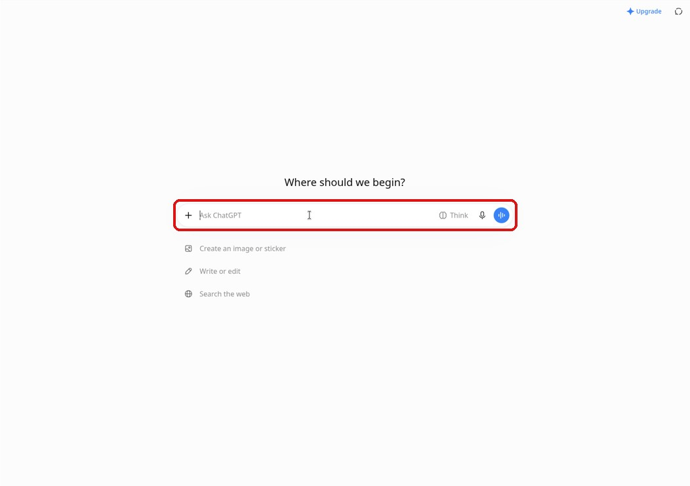
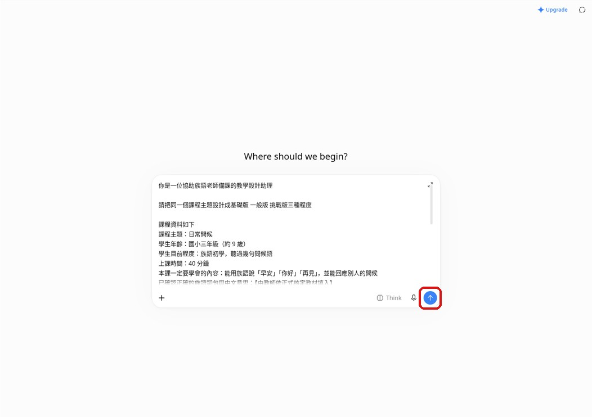
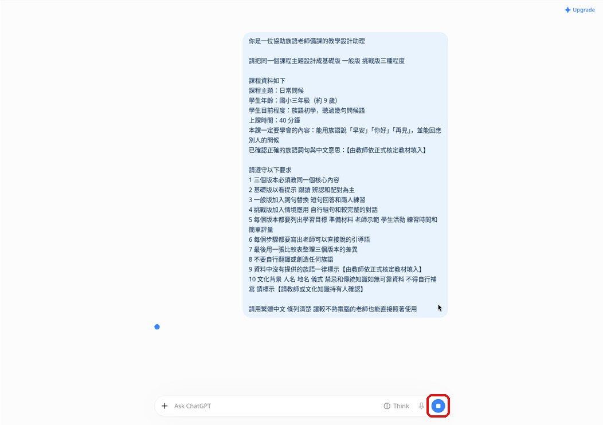
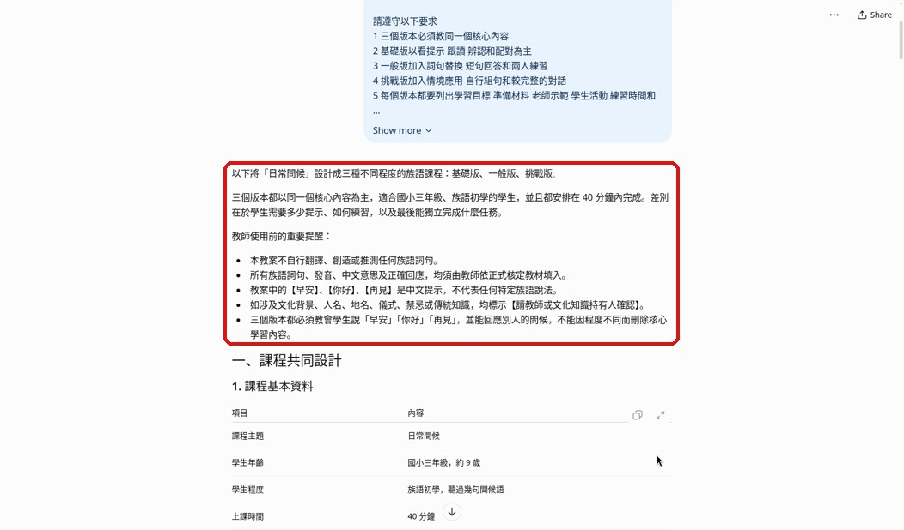
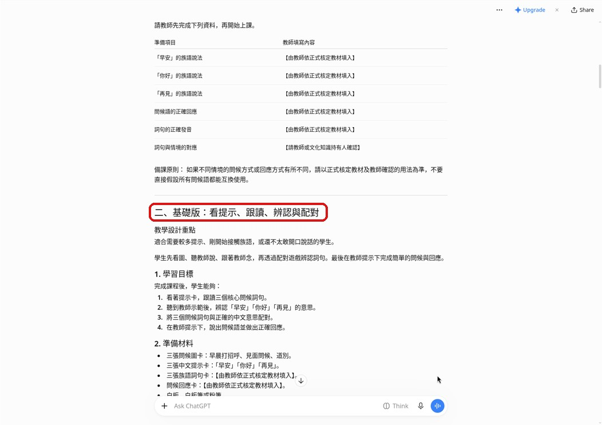
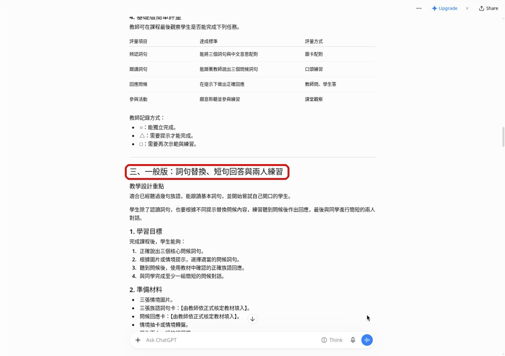
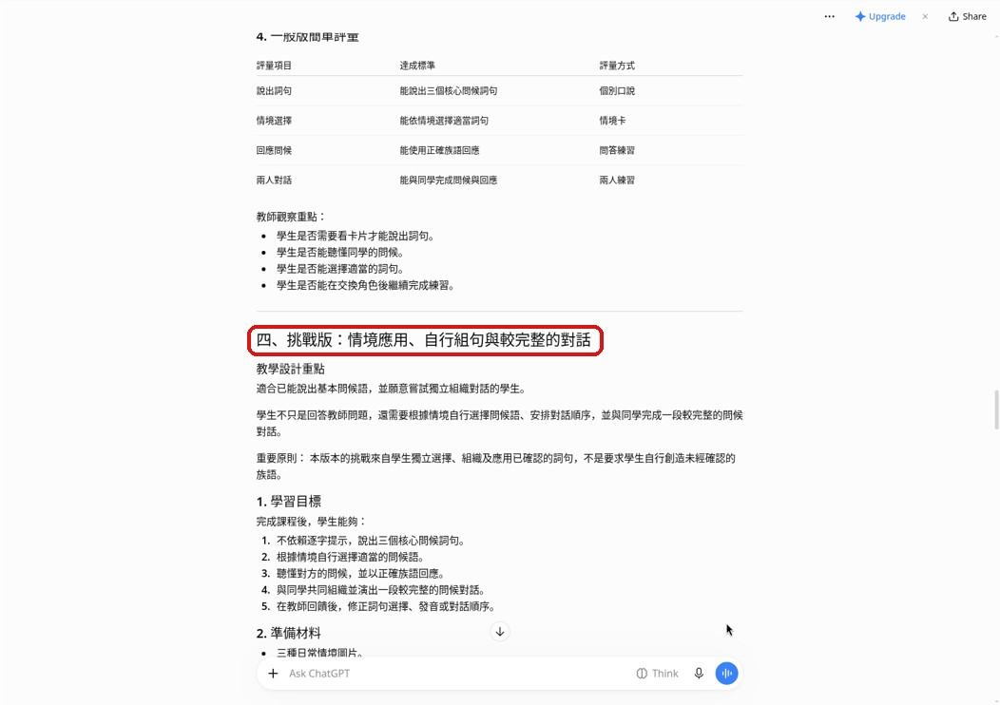
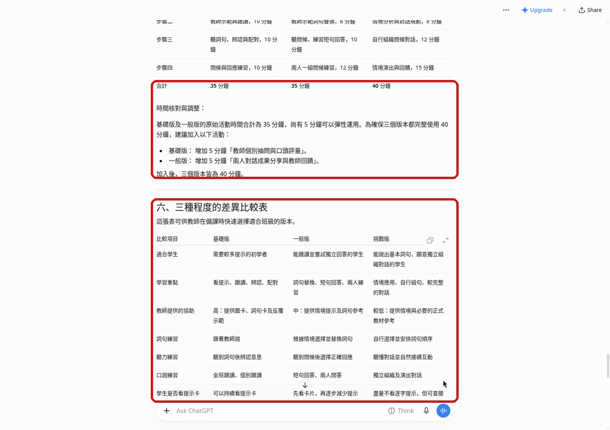
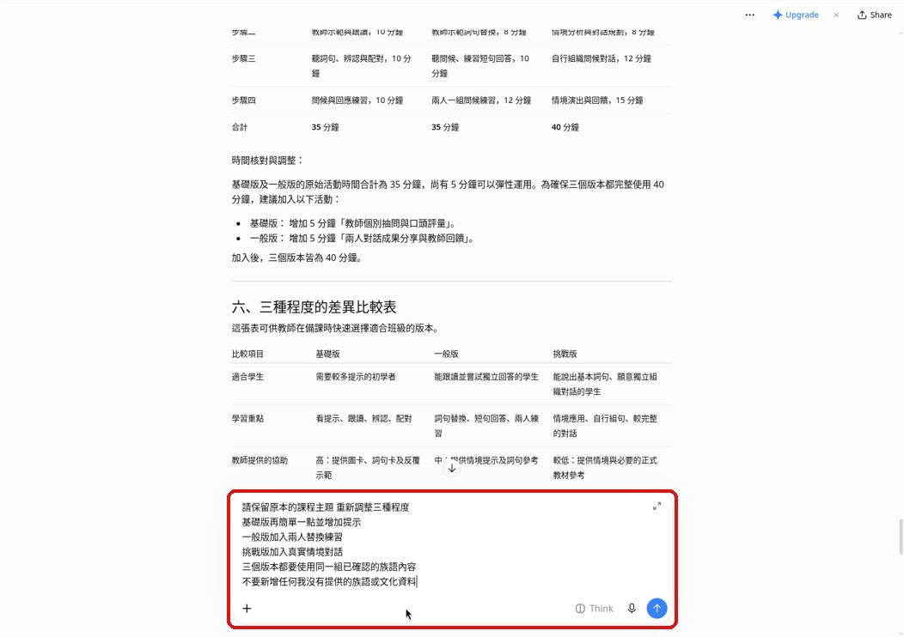
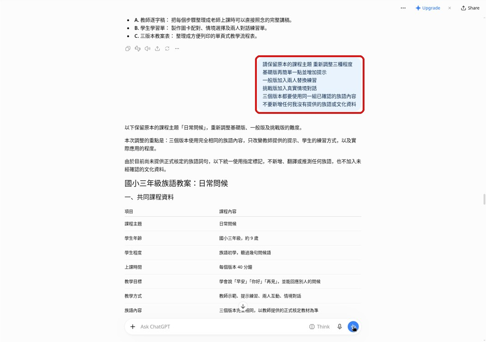

# EP018 講義：把教材包拆成三種程度

## 今天要完成什麼

把同一個族語課程主題，整理成「基礎、一般、挑戰」三種程度。三個版本教的是同一個核心內容，但練習量、回答方式與任務難度會逐步增加。

完成後，你會得到一份三種程度的教學草稿，可以依班級狀況挑選，也可以讓同一班不同程度的學生使用。

## 開始前請準備

- 一個真的要拿來上課的主題，例如日常問候、自我介紹或家庭稱謂。
- 學生的年齡與目前程度。
- 這堂課可使用的時間。
- 已經依正式資料核對正確的族語詞句、中文意思及出處。
- 原本使用的教材片段或活動內容。如果沒有完整教材，先準備這堂課一定要教會的內容即可。

> 如果族語內容尚未確認，先不要請 AI 翻譯。可以先用【由教師依正式核定教材填入】保留位置。

> 關於本講義的圖片：示範時使用的是練習用資料——主題「日常問候」、國小三年級、族語初學、上課 40 分鐘。族語詞句全部保留為【由教師依正式核定教材填入】，沒有放進任何真的族語。請老師換成自己的資料再使用。

## 步驟 1：先決定三種程度的差別

開始前，先用白話想清楚三個版本要差在哪裡：

- **基礎版**：學生可以看提示、跟著說、做辨認或配對。
- **一般版**：學生要少看一些提示，能替換詞句並完成短對話。
- **挑戰版**：學生要在情境中自行組合內容，完成較長的口說或應用任務。

三個版本不是三個不同主題，也不是把文字單純變多或變少。它們應該教同一個重點，只改變學生需要完成的難度。

## 步驟 2：打開 ChatGPT

1. 開啟 ChatGPT。
2. 在畫面下方中央找到輸入框。
3. 先點一下輸入框，確認游標正在閃動。
4. 把下一段提示詞中的方括號內容換成自己的資料。
5. 完整複製提示詞，再貼進輸入框。


> 圖說：打開新對話後，畫面中間會看到一個長長的輸入框（紅框處），裡面寫著「Ask ChatGPT」。先點一下這裡，看到游標在閃動，就可以貼上提示詞。

## 步驟 3：輸入這集專用任務

```text
你是一位協助族語老師備課的教學設計助理

請把同一個課程主題設計成基礎版 一般版 挑戰版三種程度

課程資料如下
課程主題：【填入主題】
學生年齡：【填入年齡】
學生目前程度：【填入程度】
上課時間：【填入分鐘數】
本課一定要學會的內容：【填入學習重點】
已確認正確的族語詞句與中文意思：【貼上老師已核對的內容】

請遵守以下要求
1 三個版本必須教同一個核心內容
2 基礎版以看提示 跟讀 辨認和配對為主
3 一般版加入詞句替換 短句回答和兩人練習
4 挑戰版加入情境應用 自行組句和較完整的對話
5 每個版本都要列出學習目標 準備材料 老師示範 學生活動 練習時間和簡單評量
6 每個步驟都要寫出老師可以直接說的引導語
7 最後用一張比較表整理三個版本的差異
8 不要自行翻譯或創造任何族語
9 資料中沒有提供的族語一律標示【由教師依正式核定教材填入】
10 文化背景 人名 地名 儀式 禁忌和傳統知識如無可靠資料 不得自行補寫 請標示【請教師或文化知識持有人確認】

請用繁體中文 條列清楚 讓較不熟電腦的老師也能直接照著使用
```

## 步驟 4：確認後再送出

送出前，先看一次提示詞：

- 主題、學生程度與上課時間是否已換成自己的資料。
- 是否要求產生基礎、一般、挑戰三個版本。
- 已確認的族語詞句是否貼對，沒有混入其他課程內容。
- 【由教師依正式核定教材填入】的安全標記是否仍然保留。


> 圖說：提示詞已經貼進輸入框，但還沒送出。可以先往下捲動檢查內容。確認沒問題後，再點右下角圓形裡的向上箭頭（紅框處）。

確認後，點輸入框右下角黑色圓形中的向上箭頭一次。

> 小提醒：在示範畫面中，這個圓形按鈕是藍色的。按鈕顏色可能因版本或設定而不同，認明「向上箭頭」就可以了。

看到輸入框右側出現黑色圓形中的白色方塊，表示 ChatGPT 還在回答。先不要重複點擊，等文字停止增加，而且白色方塊消失後，再開始檢查。


> 圖說：送出後，自己的提示詞會出現在右邊。輸入框右側變成圓形裡有白色方塊（紅框處），表示 ChatGPT 還在寫。這時候先等一等，不要再按。

## 步驟 5：檢查 AI 的回覆

從回覆最上方往下看，逐項確認：

- 有基礎版、一般版、挑戰版三個完整區塊。
- 三個版本都在教同一個主題與相同的核心內容。
- 基礎版有明顯提示，學生能跟讀、辨認或配對。
- 一般版有替換詞句、短句回答或兩人練習。
- 挑戰版有情境應用、自行組句或較完整的對話。
- 每個版本都有目標、材料、老師示範、學生活動、時間與評量。
- 難度確實逐步增加，不只是文字變長。
- 沒有出現老師未提供、未核對的族語或文化資訊。

下面是示範時 ChatGPT 回覆的幾個段落，可以對照著看：


> 圖說：回覆最上面會先說明三個版本的安排，並列出「教師使用前的重要提醒」（紅框處）。示範中，AI 沒有自己寫族語，而是用【早安】【你好】【再見】當中文提示。


> 圖說：往下捲，找到「基礎版」的標題（紅框處）。上方的表格裡，族語說法都標示【由教師依正式核定教材填入】，這正是我們要的結果。


> 圖說：繼續往下，找到「一般版」的標題（紅框處）。可以看到它加入了詞句替換、短句回答和兩人練習。


> 圖說：再往下是「挑戰版」（紅框處）。注意它寫著：挑戰來自學生自己選擇與組合已確認的詞句，而不是要學生自己創造族語。


> 圖說：上面的紅框是各版本的時間合計：基礎版 35 分鐘、一般版 35 分鐘、挑戰版 40 分鐘。下面的紅框是「三種程度的差異比較表」，可以一眼看出三個版本差在哪裡。

> 示範中的真實發現：ChatGPT 第一版的時間表裡，基礎版和一般版加起來都只有 35 分鐘，不是 40 分鐘。AI 自己在後面補充，建議兩個版本各再加 5 分鐘的活動。這就是為什麼老師一定要自己把分鐘數加一次——AI 排的時間不一定剛好。

如果內容不符合，可以接著輸入：

```text
請保留原本的課程主題 重新調整三種程度
基礎版再簡單一點並增加提示
一般版加入兩人替換練習
挑戰版加入真實情境對話
三個版本都要使用同一組已確認的族語內容
不要新增任何我沒有提供的族語或文化資料
```


> 圖說：把修改用的提示詞貼進同一個對話下方的輸入框（紅框處）。檢查文字沒有貼錯，再點右下角的向上箭頭送出。


> 圖說：送出後，右邊會出現剛才的修改要求（紅框處），下面是 AI 重新調整的版本。示範中，AI 說明三個版本使用完全相同的族語內容，族語仍然保留標記，沒有自己補上。新版本一樣要從頭再檢查一次。

## AI 回覆檢查點

- [ ] 三種程度都完整，沒有少一個版本。
- [ ] 三個版本的學習重點一致。
- [ ] 活動難度由基礎到挑戰逐步增加。
- [ ] 每一步都有老師可以直接使用的引導語。
- [ ] 活動時間加總沒有超過實際上課時間。
- [ ] 評量方式能看出學生是否真的理解或會說。
- [ ] 所有族語詞句都已由老師依正式教材核對。
- [ ] 文化內容沒有猜測、杜撰或過度概括。

## 族語與文化安全提醒

- AI 可以協助整理活動與難度，但不能代替族語老師判斷語音、語法、方言別與使用情境。
- 不要因為 AI 寫得很流暢，就直接把它當成正確族語。
- 涉及部落歷史、祭儀、禁忌、傳統領域、親屬關係或身分認同時，應由文化知識持有人確認。
- 未公開、受限制或不適合課堂傳播的文化知識，不要貼進公開的 AI 服務。
- 不要輸入學生姓名、聯絡方式、成績或其他可辨識個人的資料。

## 下一步

選一個最符合目前班級的版本，先實際試教其中一個活動。記下學生在哪裡需要更多提示、哪裡太簡單，再回來調整三種程度。保存前，請為檔案加上主題與日期，方便下次找到。
