# EP019 講義：做一份可列印學習單與答案

## 今天要完成什麼

完成一份可以列印的學生學習單，以及一份題號完全對應的教師版答案。學習單會保留足夠的作答空間，教師版則會補上答案、帶領方式與評量提醒。

## 開始前請準備

- 本次學習單的課程主題。
- 學生的年齡與目前程度。
- 預計作答時間與題目數量。
- 已經依正式資料核對正確的族語詞句、中文意思及出處。
- 想使用的題型，例如配對、圈選、填空、排列或口說任務。
- 紙張大小。一般列印可先選 A4 直式。

> 學習單要先決定「學生要做什麼」，再決定版面。題目少一點、字大一點、作答空間清楚，通常比塞滿一頁更好使用。

> 關於本講義的圖片：示範時使用的是練習用資料——主題「日常問候」、國小三年級、族語初學、作答時間 15 分鐘、6 題，題型為配對、圈選、排列和口說。族語詞句全部保留為【由教師依正式核定教材填入】，沒有放進任何真的族語。請老師換成自己的資料再使用。

## 步驟 1：先決定學習單內容

開始前，先寫下這四件事：

1. 這張學習單要檢查哪一個學習重點。
2. 學生大約有幾分鐘可以完成。
3. 學生需要寫字、圈選、連線，還是開口回答。
4. 哪些題目有固定答案，哪些題目需要老師依口說表現判斷。

如果有聽辨題，還要準備老師要朗讀的正確內容。不要讓 AI 自行補出族語讀音或句子。

## 步驟 2：打開 ChatGPT

1. 開啟 ChatGPT。
2. 在畫面下方中央找到輸入框。
3. 點一下輸入框，確認游標正在閃動。
4. 先把下方提示詞中的方括號內容換成自己的資料。
5. 完整複製提示詞，再貼進輸入框。


> 圖說：打開新對話後，畫面中間會看到一個長長的輸入框（紅框處），裡面寫著「Ask ChatGPT」。先點一下這裡，看到游標在閃動，就可以貼上提示詞。

## 步驟 3：輸入這集專用任務

```text
你是一位協助族語老師設計學習單的教學助理

請依照以下資料製作一份 A4 直式 可列印的學生學習單 並另外製作題號一致的教師版答案

課程主題：【填入主題】
學生年齡：【填入年齡】
學生程度：【填入程度】
預計作答時間：【填入分鐘數】
題目總數：【填入題數】
希望使用的題型：【例如配對 圈選 填空 排列 口說】
本課學習重點：【填入學習重點】
已確認正確的族語詞句與中文意思：【貼上老師已核對的內容】

學生版請包含
1 清楚的標題與簡短作答說明
2 姓名 班級 日期欄位
3 題號連續且容易辨認
4 每題保留足夠的圈選 連線或書寫空間
5 如有聽辨題 請另外列出老師朗讀內容的位置
6 最後加入一個簡短口說或兩人互動任務

教師版請包含
1 與學生版完全相同的題號
2 每一題的答案或可接受答案
3 需要老師朗讀 示範或提醒的內容
4 口說任務的評量重點 包含開口使用族語 依示範完成口說 理解互動流程 與同學合作
5 哪些地方必須由老師再次確認

請注意
不要自行翻譯或創造任何族語
資料中沒有提供的族語一律標示【由教師依正式核定教材填入】
文化背景 人名 地名 儀式 禁忌和傳統知識如無可靠資料 不得自行補寫 請標示【請教師或文化知識持有人確認】
請用繁體中文 排版清楚 避免過小的字與過度擁擠的題目
```

## 步驟 4：確認後再送出

送出前，先確認：

- 主題、程度、題數與作答時間都已填好。
- 提示詞同時要求學生版與教師版答案。
- 題型符合學生能力，不會全部都要寫很多字。
- 已確認的族語內容貼對，沒有混入別課資料。

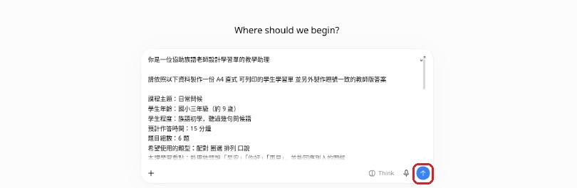
> 圖說：提示詞已經貼進輸入框，但還沒送出。可以先在框裡往下捲動，檢查內容。確認沒問題後，再點右下角圓形裡的向上箭頭（紅框處）。

確認後，點輸入框右下角黑色圓形中的向上箭頭一次。

> 小提醒：在示範畫面中，這個圓形按鈕是藍色的。按鈕顏色可能因版本或設定而不同，認明「向上箭頭」就可以了。

看到輸入框右側出現黑色圓形中的白色方塊，表示 ChatGPT 還在回答。等文字停止增加，而且白色方塊消失後，再開始檢查。

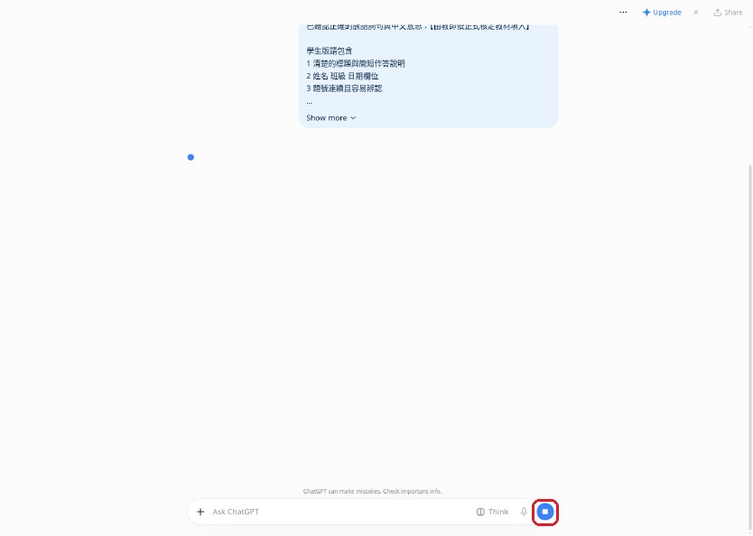
> 圖說：送出後，自己的提示詞會出現在右上方。輸入框右側變成圓形裡有白色方塊（紅框處），表示 ChatGPT 還在做。這時候先等一等，不要再按。

### 看懂 ChatGPT 的回覆

示範中，ChatGPT 沒有把整份學習單直接寫在對話裡，而是做了兩件事：

1. 在對話裡寫一段簡短說明，列出 6 題的題型與重點。
2. 另外做好一個 PDF 檔案。第 1 頁是學生版，第 2 頁是教師版。

真正要列印的是那個 PDF 檔案。對話裡的說明可以先快速看過，確認方向對不對。

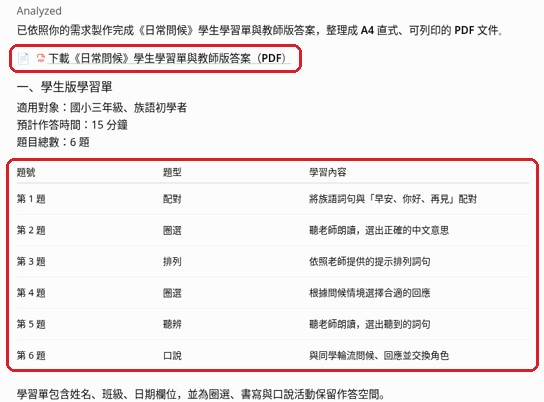
> 圖說：回覆最上面寫著已經整理成 A4 直式、可列印的 PDF。上面的紅框是 PDF 的下載連結，下面的紅框是學生版 6 題的摘要：題號、題型和學習內容。

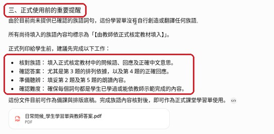
> 圖說：往下捲，會看到「正式使用前的重要提醒」（上面紅框）。示範中 AI 說明它沒有自行創造或翻譯族語，並列出老師要先核對族語、確認答案、準備聽辨、確認難度（下面紅框）。

### 點開 PDF 卡片並下載

1. 在回覆最下方，找到寫著檔名、下面有「PDF」字樣的長方形卡片。
2. 點一下這張卡片，右邊會打開一個預覽區。
3. 點預覽區右上角的「下載」圖示（一個向下的箭頭）。
4. 跳出小選單後，點「PDF」。
5. 檔案通常會存到電腦的「下載」資料夾。


> 圖說：這就是 PDF 檔案卡片（紅框處）。示範中的檔名是「日常問候_學生學習單與教師答案.pdf」。點一下它。

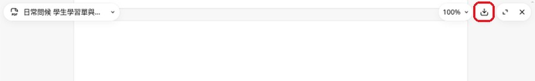
> 圖說：預覽區打開後，看最上面那一排小工具。紅框處是下載圖示，點它。

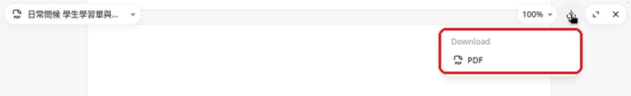
> 圖說：跳出的小選單寫著「Download」，下面有「PDF」（紅框處）。點「PDF」，檔案就會下載到電腦。

> 示範中的真實狀況：ChatGPT 內建預覽有時看不到中文字，畫面上只有空白的表格。這不是檔案壞了。下載後用電腦的 PDF 閱讀器打開就正常。所以請不要只看預覽，一定要下載下來檢查。

### 用電腦的 PDF 閱讀器打開

1. 打開電腦的「下載」資料夾。
2. 找到剛剛下載的 PDF 檔，點兩下打開。
3. 先看第 1 頁的學生版，再看第 2 頁的教師版。

## 步驟 5：先檢查學生版

從學生版最上方開始看：

- 有標題、作答說明、姓名、班級與日期欄。
- 題號從頭到尾連續，沒有跳號或重複。
- 每一題都看得出要圈選、連線、填寫還是開口回答。
- 書寫題下方有足夠空間。
- 聽辨題有老師朗讀內容，但沒有要求學生看答案作答。
- 最後的口說或互動任務清楚，學生知道先做什麼、再做什麼。

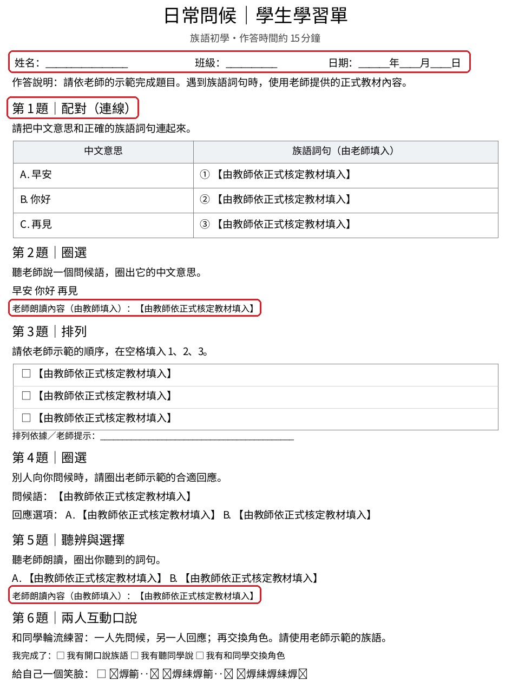
> 圖說：這是示範中下載的 PDF 第 1 頁（學生版）。最上面的紅框是姓名、班級、日期欄；「第 1 題｜配對（連線）」的紅框提醒你看題號和題型；第 2 題和第 5 題下方的紅框是「老師朗讀內容」的位置。族語都還是【由教師依正式核定教材填入】，要由老師自己補上。

## 步驟 6：再檢查教師版答案

教師版不能只寫「答案略」。請逐題核對：

- 題號與學生版完全一致。
- 固定答案沒有遺漏。
- 可以有不同答案的題目，已寫出可接受範圍。
- 聽辨題有正確的朗讀順序與內容。
- 口說評量有清楚觀察點。
- 所有族語都來自老師提供並已經核對的資料。

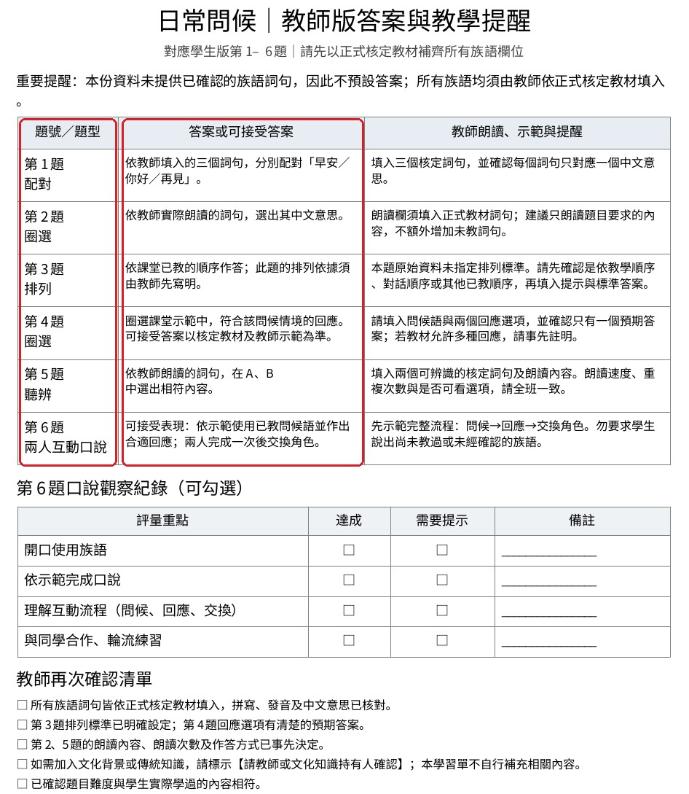
> 圖說：這是同一個 PDF 的第 2 頁（教師版）。左邊紅框是「題號／題型」，請一題一題對照學生版；右邊紅框是「答案或可接受答案」。示範中，因為沒有提供族語，AI 沒有預設族語答案，而是寫出判斷方式，請老師依正式教材補上。

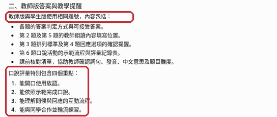
> 圖說：對話裡也有教師版的說明。上面紅框寫著教師版與學生版使用相同題號；下面紅框是口說評量的四個重點：開口使用族語、依示範完成口說、理解互動流程、與同學合作。

如果題號或答案對不起來，可以接著輸入：

```text
請重新核對學生版與教師版
保留原本題目內容
把兩個版本的題號調整成完全一致
逐題補上教師版答案與帶領提醒
書寫題請增加作答空間
不要新增任何我沒有提供的族語或文化資料
```

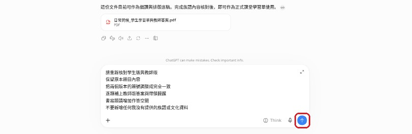
> 圖說：把修改用的提示詞貼進同一個對話下方的輸入框。檢查文字沒有貼錯，再點右下角的向上箭頭（紅框處）送出。

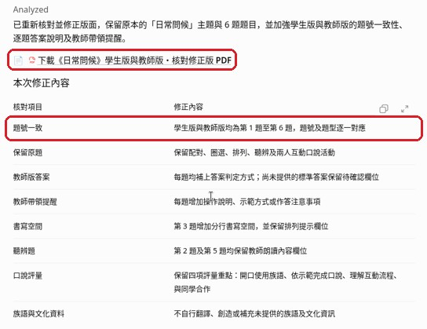
> 圖說：示範中，ChatGPT 列出「本次修正內容」。上面紅框是新版 PDF 的下載連結；下面紅框寫著學生版與教師版都是第 1 題至第 6 題，題號和題型逐一對應。

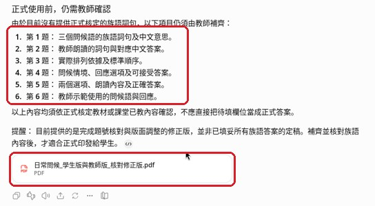
> 圖說：回覆最後列出「正式使用前，仍需教師確認」的第 1 到第 6 題（上面紅框），下面是新的 PDF 檔案卡片（下面紅框）。修正版是另一個新檔案，要照前面的方法再下載一次，從頭再檢查一次。

## 步驟 7：列印前預覽

把確認過的內容放進你平常使用的文件工具，再做一次列印預覽。如果直接使用 ChatGPT 做好的 PDF，就用 PDF 閱讀器打開，選「列印」，先看預覽畫面：

- 紙張選 A4，確認直式或橫式符合原先設計。
- 字不要太小，題目與作答區不要被切到下一頁。
- 學生版不要不小心印出教師答案。
- 先試印一份，拿筆實際作答一次，確認空間足夠。


> 圖說：示範中的真實發現：學生版最後一行「給自己一個笑臉」後面，原本是讓學生選笑臉的地方，結果變成一串方塊和看不懂的字（紅框處）。這是 AI 做檔案時字型出了問題。第二次修正後的版本，這一行一樣是亂碼。

> 這就是為什麼一定要先預覽、先試印。看到這種亂碼，可以請 ChatGPT 改成簡單的文字，或在文件工具裡自己修改，也可以印出來後用筆手畫笑臉。不要直接把有亂碼的學習單發給學生。

## AI 回覆檢查點

- [ ] 學生版有姓名、班級、日期與清楚作答說明。
- [ ] 題型與題數符合學生程度及上課時間。
- [ ] 每題都有足夠作答空間。
- [ ] 教師版答案完整，不是只有簡略提示。
- [ ] 學生版與教師版的題號完全一致。
- [ ] 口說評量包含開口、示範、互動與合作。
- [ ] 所有族語詞句都已由老師依正式教材核對。
- [ ] 列印預覽沒有截字、跑版或答案誤印在學生版。

## 族語與文化安全提醒

- AI 可以協助設計題型與整理版面，但不能判定族語翻譯、拼寫、語法或方言別是否正確。
- 聽辨與口說題應使用老師確認過的內容與發音，不要採用 AI 自行生成的族語。
- 文化情境題要避免把單一部落或個人的經驗寫成所有族人的共同規則。
- 涉及儀式、禁忌、傳統知識或未公開內容時，要先取得適當同意並由文化知識持有人確認。
- 學習單範例不要放入學生真實姓名、成績、聯絡方式或其他個人資料。

## 下一步

先試印一份學生版與一份教師版，自己完整做過一次。確認題號、答案、作答空間與族語內容都正確後，再依實際人數列印。上課後記下學生最常卡住的題目，作為下一版調整依據。
