# EP020 講義：做口說練習腳本

## 今天要完成什麼

完成一套可以直接帶進課堂的口說練習流程，依序包含老師示範、學生跟讀、詞句替換與兩人對話。每一步都會有老師可以直接說的引導語，也會保留族語內容的內容核對位置。

## 開始前請準備

- 一個學生真的可能遇到的口說情境，例如見面問候、自我介紹、詢問姓名或介紹家人。
- 學生的年齡與目前程度。
- 可使用的上課時間。
- 每組學生預計練習的句數與次數。
- 已經依正式資料核對正確的族語句型、替換詞與中文意思。
- 如果有文化情境，準備可靠來源或可以協助確認的文化知識持有人。

> 先選一個短而真實的情境。初學者能把兩到四句話說清楚，比一次塞進很多句子更重要。

> 關於本講義的圖片：示範時使用的是練習用資料——情境「早上到學校互相問候」、國小三年級、族語初學、活動時間 20 分鐘、2 組問答共 4 句（早安、你好嗎、我很好，以及替換詞「老師／同學」）。族語句型與替換詞全部保留為【由教師依正式核定教材填入】，沒有放進任何真的族語。請老師換成自己的資料再使用。

## 步驟 1：先寫出口說練習的骨架

先決定四個練習要做什麼：

1. **老師示範**：老師先完整說一次，讓學生知道速度、語氣與互動順序。
2. **學生跟讀**：老師說一句，學生跟著說一句。
3. **替換練習**：保留句型，只替換一個已確認的詞。
4. **兩人對話**：學生分成甲、乙兩個角色，依順序完成短對話。

如果句型與替換詞還沒核對完成，先保留空格，不要請 AI 自行翻譯。

## 步驟 2：打開 ChatGPT

1. 開啟 ChatGPT。
2. 在畫面下方中央找到輸入框。
3. 點一下輸入框，確認游標正在閃動。
4. 把下一段提示詞中的方括號內容換成自己的資料。
5. 完整複製提示詞，再貼進輸入框。

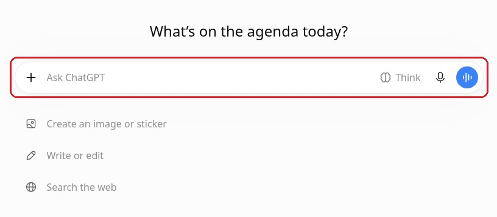
> 圖說：打開新對話後，畫面中間會看到一個長長的輸入框（紅框處），裡面寫著「Ask ChatGPT」。先點一下這裡，看到游標在閃動，就可以貼上提示詞。

## 步驟 3：輸入這集專用任務

```text
你是一位協助族語老師設計口說活動的教學助理

請依照以下資料設計一套可以直接帶領的口說練習腳本

口說情境：【填入真實情境】
學生年齡：【填入年齡】
學生程度：【填入程度】
活動時間：【填入分鐘數】
每組練習句數：【填入句數】
學習目標：【填入學生最後要能說出的內容】
已確認正確的族語句型 替換詞與中文意思：【貼上老師已核對的內容】

請依照以下順序設計
1 老師示範
2 學生逐句跟讀
3 保留句型的替換練習
4 甲乙兩人的短對話
5 交換角色再練習一次
6 老師最後的口說檢查

每一個步驟都要包含
老師可以直接說的引導語
學生要做的動作
建議練習次數
預計使用時間
學生卡住時可以給的提示
老師要觀察的重點

請注意
由淺到深安排 每次只增加一個新要求
初學者的句子要短 並保留足夠重複練習
不要自行翻譯或創造任何族語
資料中沒有提供的族語一律標示【由教師依正式核定教材填入】
文化背景 人名 地名 儀式 禁忌和傳統知識如無可靠資料 不得自行補寫 請標示【請教師或文化知識持有人確認】
請用繁體中文 條列清楚 讓老師能直接照順序帶領
```

## 步驟 4：確認後再送出

送出前，先確認：

- 情境是真實而且適合學生的。
- 程度、時間與練習句數已換成自己的資料。
- 提示詞包含老師示範、學生跟讀、替換練習與兩人對話。
- 貼入的族語句型與替換詞都已由老師核對。

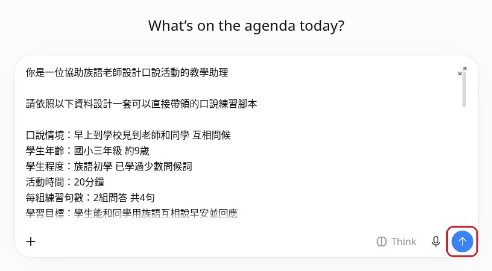
> 圖說：提示詞已經貼進輸入框，但還沒送出。提示詞很長，可以先在框裡往下捲動，檢查情境、年級、時間和句數都填對了。確認沒問題後，再點右下角圓形裡的向上箭頭（紅框處）。

確認後，點輸入框右下角黑色圓形中的向上箭頭一次。

> 小提醒：在示範畫面中，這個圓形按鈕是藍色的。按鈕顏色可能因版本或設定而不同，認明「向上箭頭」就可以了。

看到輸入框右側出現黑色圓形中的白色方塊，表示 ChatGPT 還在回答。請等文字停止增加，而且白色方塊消失後，再繼續。

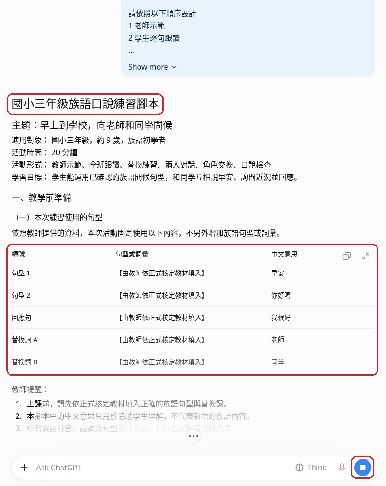
> 圖說：送出後，自己的提示詞會出現在右上方，ChatGPT 開始寫「國小三年級族語口說練習腳本」（上面紅框）。輸入框右側變成圓形裡有白色方塊（右下紅框），表示還在回答，先等一等，不要再按。中間紅框是「本次練習使用的句型」表：句型 1、句型 2、回應句和兩個替換詞，族語欄全部是【由教師依正式核定教材填入】。

> 示範中的真實狀況：兩次回覆都沒有自己編出任何族語，每一個族語位置都保留【由教師依正式核定教材填入】。這正是我們要的結果。如果你看到回覆裡突然出現你沒有提供的族語詞句，不要直接使用，請刪掉或換回老師核對過的內容。

## 步驟 5：按順序檢查四個主要練習

回覆完成後，從上往下找：

1. 老師示範。
2. 學生跟讀。
3. 替換練習。
4. 甲乙兩人對話。

確認四個部分都有完整內容，而且順序沒有顛倒。對較不熟悉族語口說的學生，應該先聽、再跟著說、接著替換，最後才獨立對話。

示範中，ChatGPT 依照提示詞的六個順序，把腳本寫成「步驟一」到「步驟六」，前面還有一張活動流程時間表。可以先看時間表，再一段一段往下找。

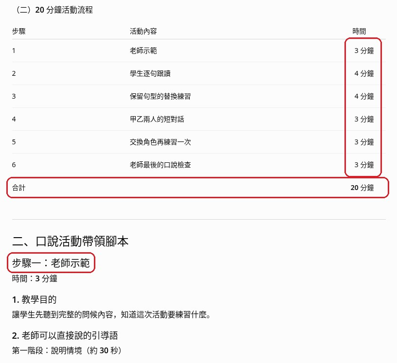
> 圖說：「20 分鐘活動流程」表列出六個步驟。右邊紅框是每一步的時間：3、4、4、3、3、3 分鐘；下面紅框是「合計 20 分鐘」，剛好等於提示詞裡填的活動時間。再往下就是「步驟一：老師示範」（紅框處）。

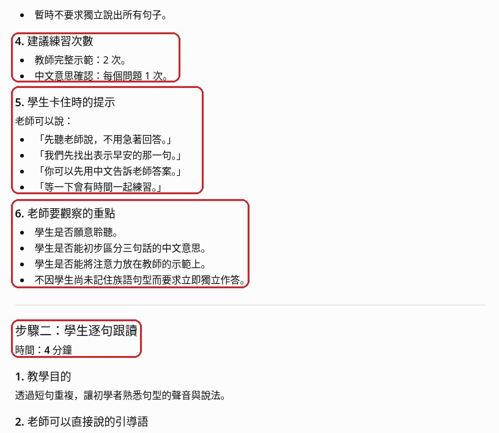
> 圖說：這是「步驟一：老師示範」的後半段。紅框依序是「建議練習次數」、「學生卡住時的提示」（老師可以直接說的話）和「老師要觀察的重點」。最下面紅框是接著開始的「步驟二：學生逐句跟讀」，時間 4 分鐘。

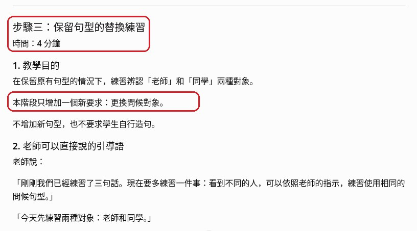
> 圖說：「步驟三：保留句型的替換練習」（上面紅框）。下面紅框寫著「本階段只增加一個新要求：更換問候對象」，也就是句型不變，只把「老師」換成「同學」。這符合提示詞「每次只增加一個新要求」。

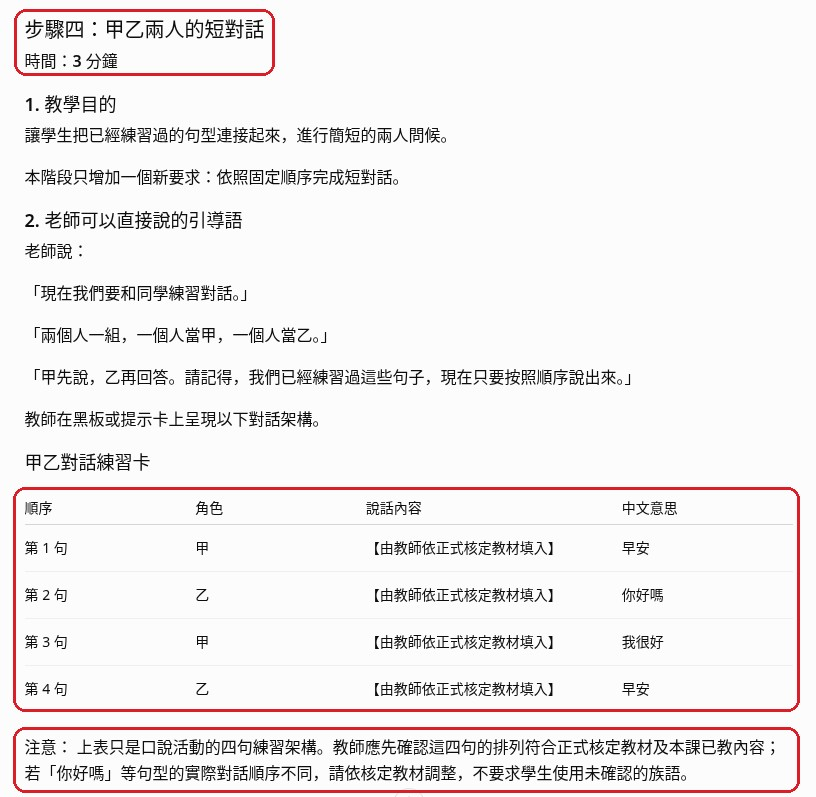
> 圖說：「步驟四：甲乙兩人的短對話」（上面紅框）。中間紅框是「甲乙對話練習卡」：第 1 句到第 4 句，標出甲或乙、說話內容和中文意思，說話內容全部是【由教師依正式核定教材填入】。最下面紅框是 AI 自己加上的注意事項。

> 示範中的真實狀況：ChatGPT 自己提醒，這四句的排列（甲說早安、乙問你好嗎、甲回我很好、乙再說早安）只是練習架構，「你好嗎」等句子實際的對話順序可能不同，請老師依核定教材調整。AI 不懂真實的族語對話習慣，這就是為什麼甲乙每一句的順序，都要由老師對照正式教材再確認一次。

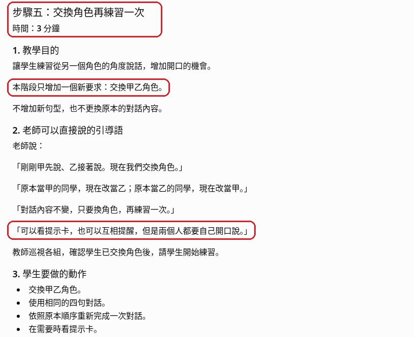
> 圖說：「步驟五：交換角色再練習一次」（上面紅框）。中間紅框寫著這一步只增加「交換甲乙角色」；下面紅框是老師可以直接說的引導語：「可以看提示卡，也可以互相提醒，但是兩個人都要自己開口說。」

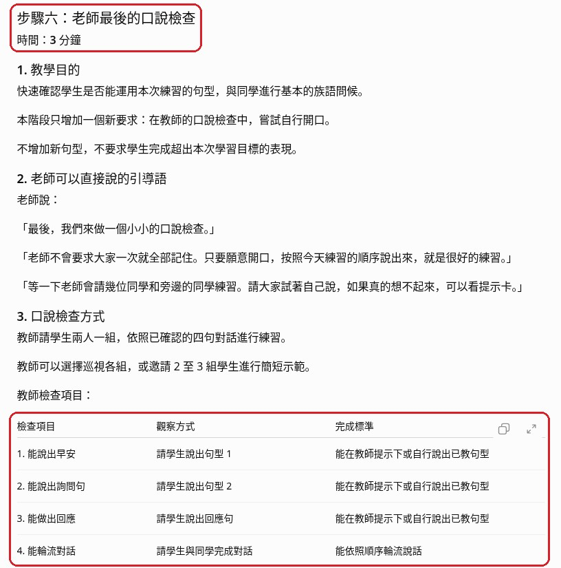
> 圖說：「步驟六：老師最後的口說檢查」（上面紅框）。下面紅框是「教師檢查項目」表，列出四個檢查項目：能說出早安、能說出詢問句、能做出回應、能輪流對話，以及每一項的觀察方式和完成標準。

## 步驟 6：檢查老師是否能直接帶領

每一段都要看得到：

- 老師開場要說什麼。
- 學生要聽、跟讀、替換還是輪流回答。
- 要練習幾次。
- 學生卡住時，老師要給哪一種提示。
- 完成後，老師要觀察發音、理解、互動順序還是流暢度。

如果步驟太快或太難，可以接著輸入：

```text
請保留原本的口說情境和已確認的族語內容
把活動調整得更適合初學者
老師每說一句後都安排學生跟讀
替換練習一次只換一個詞
兩人對話先提供完整提示 再安排第二次不看提示
每一步補上老師可以直接說的引導語
不要新增任何我沒有提供的族語或文化資料
```

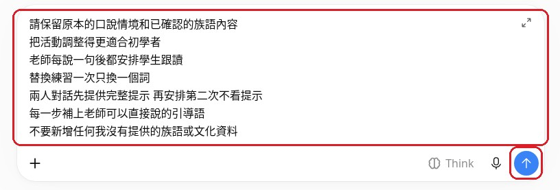
> 圖說：把調整用的提示詞貼進同一個對話下方的輸入框（上面紅框）。檢查文字沒有貼錯，再點右下角的向上箭頭（紅框處）送出。

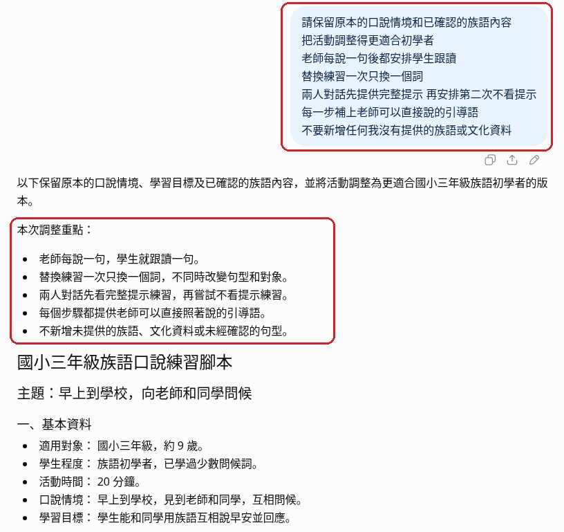
> 圖說：右上方紅框是剛送出的第二段提示詞。下面紅框是 ChatGPT 列出的「本次調整重點」：老師每說一句學生就跟讀一句、替換一次只換一個詞、兩人對話先看提示再試著不看提示、每步都有引導語、不新增未提供的族語。下面接著是重新整理過的完整腳本，一樣是六個步驟、合計 20 分鐘。

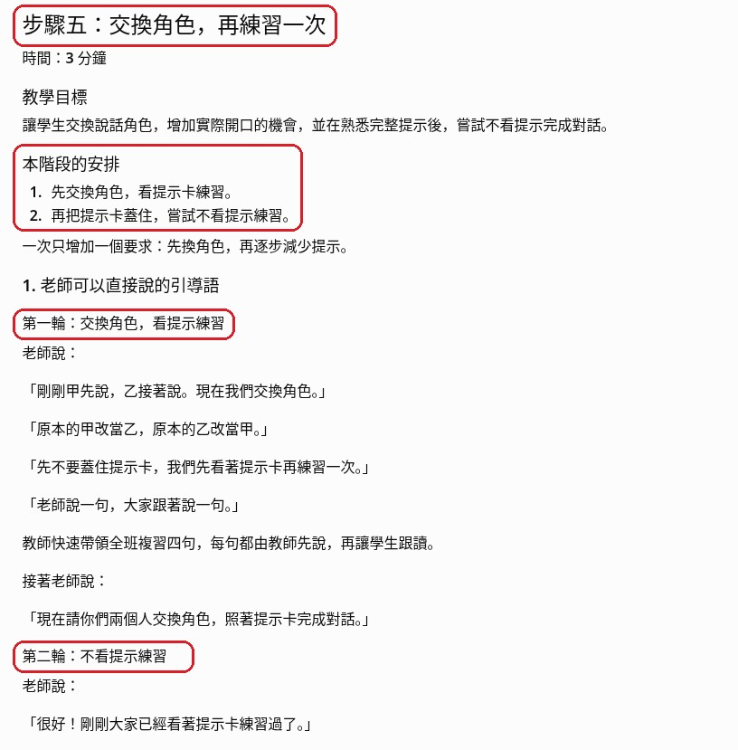
> 圖說：調整後的「步驟五：交換角色，再練習一次」（上面紅框）。「本階段的安排」（第二個紅框）分成兩輪：「第一輪：交換角色，看提示練習」和「第二輪：不看提示練習」（下面兩個紅框），第二輪會把提示卡蓋住。

> 示範中的真實狀況：提示詞要求「兩人對話先提供完整提示，再安排第二次不看提示」。但在調整後的回覆裡，「不看提示」的練習沒有放在步驟四的兩人對話，而是放到步驟五交換角色時才出現。AI 不一定會把要求放在你預期的位置。請老師找一找這個要求被放在哪一步，再決定要照用，或自己移回步驟四。

## 步驟 7：試念並調整時間

正式上課前，老師先自己念過完整流程：

- 每一句是否太長，學生能不能一次聽清楚。
- 示範與跟讀之間是否留有足夠停頓。
- 替換詞的數量是否太多。
- 甲乙角色是否清楚，學生會不會不知道輪到誰。
- 所有練習加總是否能在預定時間內完成。

> 示範中的真實狀況：兩次回覆都是六個步驟，時間是 3＋4＋4＋3＋3＋3＝20 分鐘，剛好符合上課時間。但這是 AI 估的時間。老師自己念一次，才知道真正需要幾分鐘。

如果時間不夠，優先減少替換詞與對話輪數，不要省略老師示範和學生跟讀。

## AI 回覆檢查點

- [ ] 老師示範、學生跟讀、替換練習、兩人對話都完整。
- [ ] 練習順序由簡單到困難，每次只增加一個要求。
- [ ] 每一步都有老師可以直接使用的引導語。
- [ ] 每一句的長度與練習次數符合學生程度。
- [ ] 甲乙角色、輪流順序與交換角色方式都清楚。
- [ ] 活動總時間沒有超過實際上課時間。
- [ ] 所有族語句子、發音與使用情境都已由老師核對。
- [ ] 文化內容沒有猜測、杜撰或不適合公開的資訊。

## 族語與文化安全提醒

- AI 可以協助安排練習順序，但不能代替老師判斷發音、語法、方言別、敬語與實際使用情境。
- 口說腳本中的每一句族語，都要回到正式教材、可靠來源或族語老師的判斷。
- 同一句話在不同年齡、身分、親屬關係或部落情境中，可能有不同說法，不要直接套用。
- 涉及祭儀、禁忌、傳統知識或不宜公開的內容時，要先由文化知識持有人確認。
- 練習角色請使用虛構稱呼，不要把學生真實姓名或個人資料貼進 AI。

## 下一步

先找一位同事或家人，依照腳本完整練習一次。記下哪一句不順、哪一步說明不清楚，再調整句數與時間。確認族語與文化內容正確後，保存一份老師帶領版，並另外整理學生只需要看到的對話內容。
