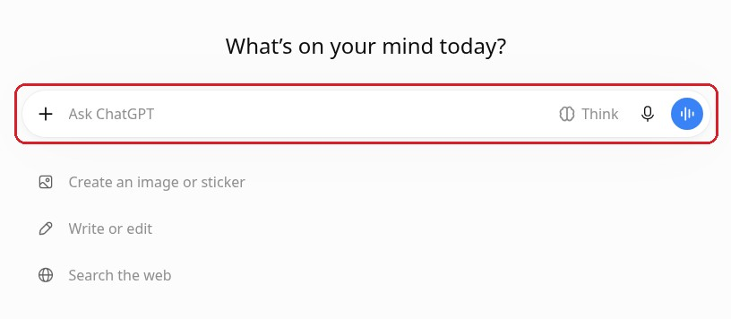
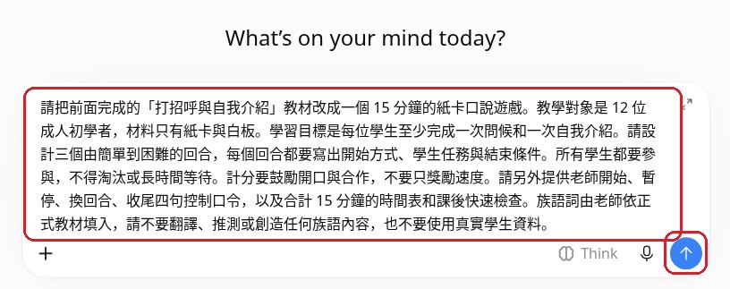
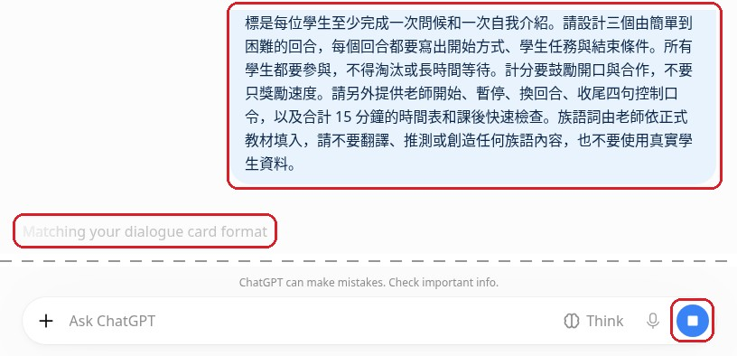
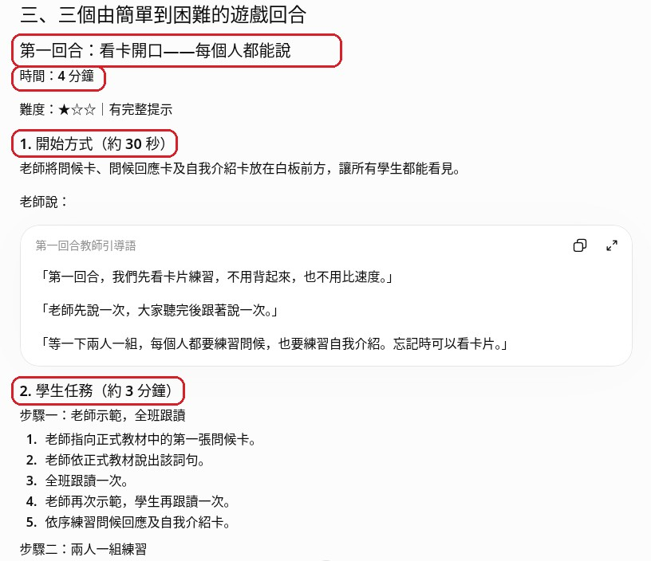
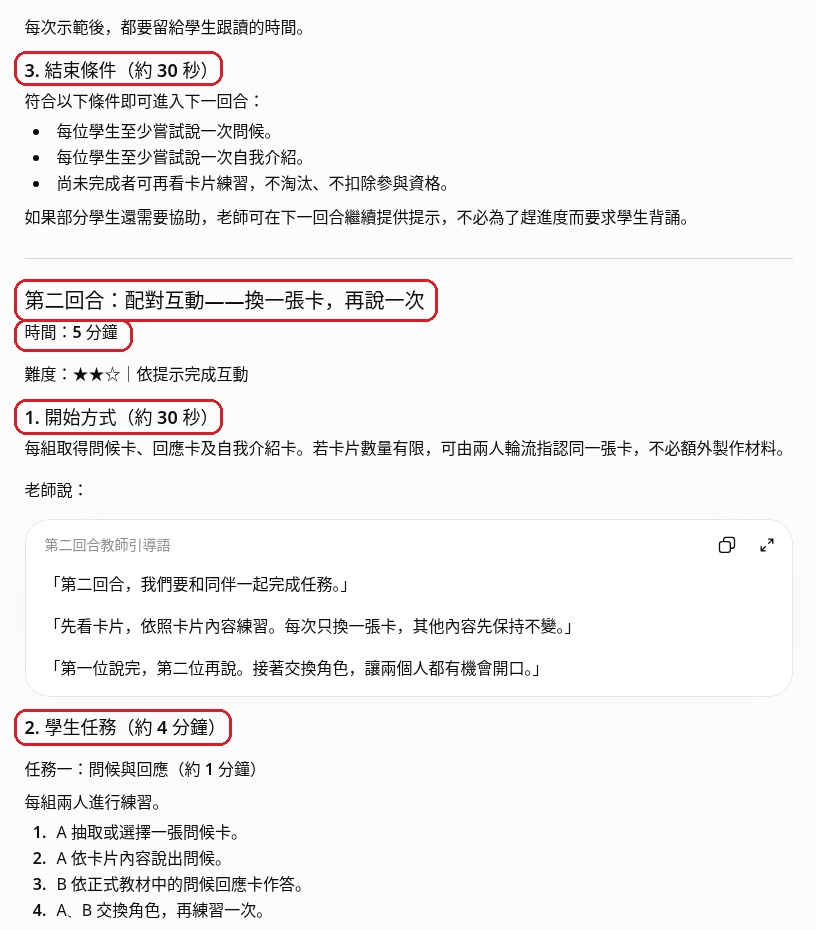
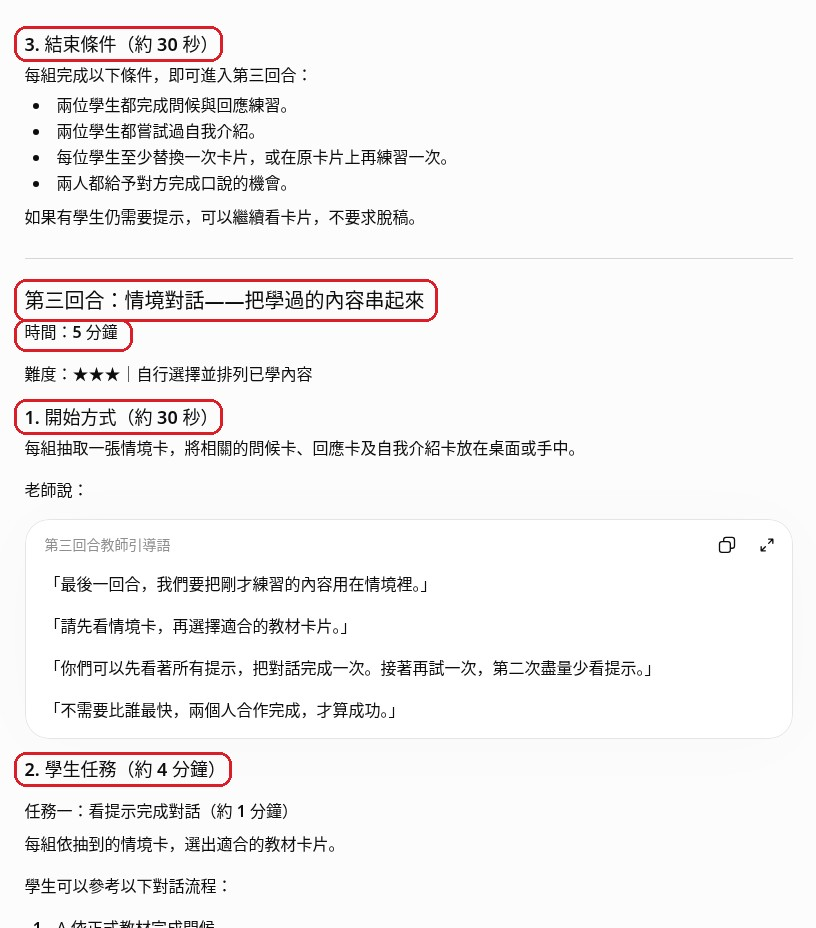
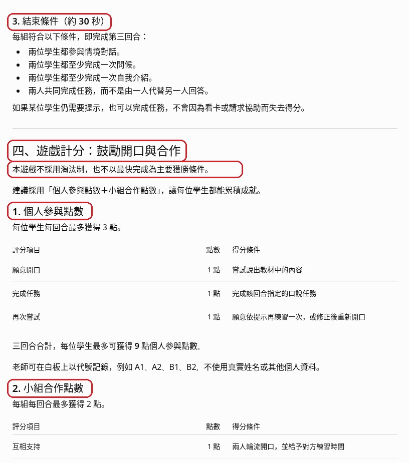
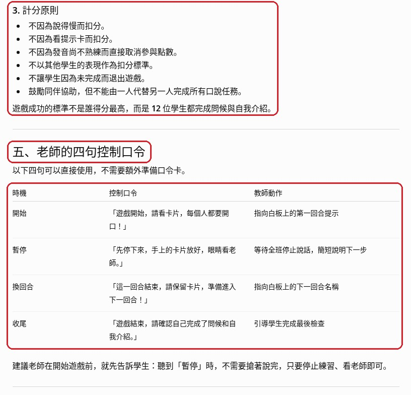
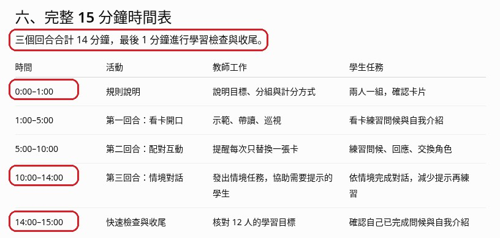
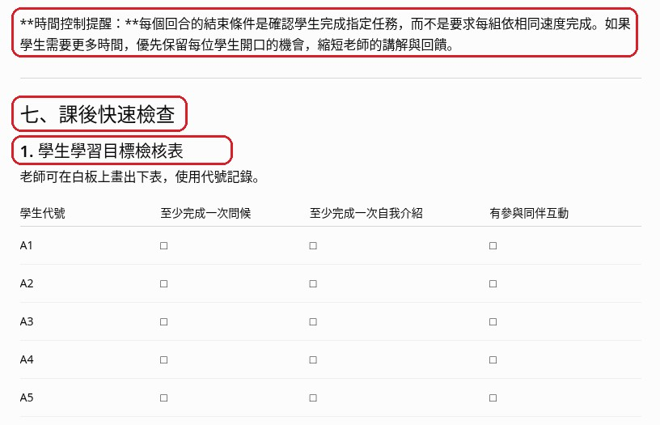

# EP021 講義：把教材變成十五分鐘遊戲課

## 這集要解決什麼

手上已經有「打招呼與自我介紹」教材，卻不知道怎麼讓全班一起開口練習。

這集不是重新做教材，而是用 ChatGPT 把現有教材整理成一個老師帶得動、學生聽得懂的紙卡口說遊戲。

## 完成後你會拿到

一份可以試教的十五分鐘遊戲稿，裡面會有：

- 三個由簡單到困難的回合。
- 每個回合的開始方式、學生任務與結束條件。
- 十二位學生都能開口、不淘汰人的參與規則。
- 鼓勵開口與合作的計分方式。
- 開始、暫停、換回合、收尾四句老師口令。
- 合計十五分鐘的時間表。

## 需要準備

- 前面完成的「打招呼與自我介紹」教材。
- 班級人數，本集示範為十二位成人初學者。
- 紙卡與白板。
- 經老師核定的族語內容。

> 關於本講義的圖片：示範時把下方「本集輸入範例」一字不改地貼進 ChatGPT 新對話送出：12 位成人初學者、材料只有紙卡與白板、15 分鐘。ChatGPT 直接用文字回覆，對話標題自動變成「設計紙卡口說遊戲」。回覆中的族語位置都是留給老師的空格，沒有任何真的族語。請老師換成自己的資料再使用。

## 操作步驟

### 步驟一：告訴 ChatGPT 班級條件

先說明教材主題、學生程度、人數、上課時間與現場材料。條件越具體，產出的遊戲越有機會真的用得上。

### 步驟二：說清楚最後要拿到什麼

要求三個遊戲回合，而且每個回合都必須寫出：

1. 老師怎麼開始。
2. 學生要做什麼。
3. 什麼情況代表回合結束。

### 步驟三：加上安全與參與限制

- 每位學生都要開口。
- 不得淘汰學生。
- 不要讓學生長時間等待。
- 族語詞由老師依正式教材填入。
- ChatGPT 不得翻譯、推測或創造族語內容。

把這三個步驟的條件寫在一起，就是下方的「本集輸入範例」。打開 ChatGPT 新對話，點一下畫面中間的輸入框，貼上輸入範例，檢查後送出。

> 圖說：打開新對話後，畫面中間會看到一個長長的輸入框（紅框處），裡面寫著「Ask ChatGPT」。先點一下這裡，看到游標在閃動，就可以貼上輸入範例。

> 圖說：輸入範例已經貼進輸入框（上面紅框），還沒送出。先看一遍：人數 12 位、材料紙卡與白板、15 分鐘、三個回合、四句口令、時間表和課後檢查都在裡面。確認後，點右下角圓形裡的向上箭頭（紅框處）。

> 圖說：送出後，自己的輸入範例會出現在右上方（上面紅框）。左邊出現灰色的小字「Matching your dialogue card format」（中間紅框），表示 ChatGPT 正在整理。下方輸入框右側變成圓形裡有白色方塊（右下紅框），表示還在回答，先等它寫完，不要再按。（這張圖把中間的空白處省略了。）

### 步驟四：檢查 AI 的遊戲稿

先找到三個回合，再逐項確認：

- 三個回合是否由簡單到困難。
- 每個回合是否看得懂學生要做什麼。
- 計分是否鼓勵開口與合作。
- 是否所有學生都能參加。
- 四句老師口令是否齊全。
- 全部流程是否能在十五分鐘內完成。

示範中，ChatGPT 的回覆依序是：遊戲基本設定與紙卡、三、三個由簡單到困難的遊戲回合、四、遊戲計分、五、老師的四句控制口令、六、完整 15 分鐘時間表、七、課後快速檢查。可以照這個順序往下找。

> 圖說：「第一回合：看卡開口——每個人都能說」（上面紅框），標題下寫「時間：4 分鐘」（第二個紅框）。下面兩個紅框是「1. 開始方式」和「2. 學生任務」：老師先示範、全班跟讀，再兩人一組練習。這一回合有完整提示，是最簡單的一回合。

> 圖說：最上面紅框是第一回合的「3. 結束條件」：每位學生至少試說一次問候和一次自我介紹，沒完成的人可以再看卡片練習，不淘汰。下面是「第二回合：配對互動——換一張卡，再說一次」，標題下寫「時間：5 分鐘」。難度加深的方式是兩人互動，而且每次只換一張卡。

> 圖說：最上面紅框是第二回合的「3. 結束條件」。下面是「第三回合：情境對話——把學過的內容串起來」，標題下寫「時間：5 分鐘」。學生要看情境卡，自己選出適合的教材卡片完成對話，第二次盡量少看提示，所以最難。

> 圖說：最上面紅框是第三回合的「3. 結束條件」：兩位學生都要參與，不能由一人代替另一人回答。下面是「四、遊戲計分：鼓勵開口與合作」，紅框寫著「本遊戲不採用淘汰制，也不以最快完成為主要獲勝條件」。分數分成「1. 個人參與點數」（願意開口、完成任務、再次嘗試）和「2. 小組合作點數」兩種（紅框處）。

> 圖說：最上面紅框是「3. 計分原則」：不因說得慢、看提示卡或發音不熟而扣分，也不讓學生退出遊戲。下面是「五、老師的四句控制口令」（紅框處），表格（紅框處）列出開始、暫停、換回合、收尾四句口令，以及老師說口令時要做的動作。

> 示範中的真實狀況：回覆裡沒有一段專門叫「參與規則」的內容。「每個人都要開口、不淘汰」這些規則，分散寫在「一、遊戲基本設定」、「四、遊戲計分」的計分原則，以及每個回合的「結束條件」裡。檢查「是否所有學生都能參加」時，要到這幾個地方找。

> 圖說：「六、完整 15 分鐘時間表」。最上面紅框的說明句寫「三個回合合計 14 分鐘，最後 1 分鐘進行學習檢查與收尾」。但表格裡開頭多了「0:00–1:00 規則說明」，第三回合只有「10:00–14:00」4 分鐘，最後是「14:00–15:00 快速檢查與收尾」（三個紅框處）。

> 示範中的真實狀況：時間對不起來，這是這集最重要的檢查點。
>
> - 三個回合的標題寫 4、5、5 分鐘，合計 14 分鐘。
> - 時間表的說明句說：三個回合 14 分鐘，加 1 分鐘收尾。
> - 但時間表本身是：規則說明 1 分鐘＋第一回合 4 分鐘＋第二回合 5 分鐘＋第三回合 4 分鐘＋收尾 1 分鐘＝15 分鐘。第三回合比標題少了 1 分鐘，開頭還多了 1 分鐘規則說明。
> - 如果照回合標題的分鐘數，再加上規則說明和收尾，總共是 1＋4＋5＋5＋1＝16 分鐘，超過 15 分鐘。
>
> 所以不要只看「合計 15 分鐘」這幾個字，老師要自己把每一段的分鐘數加起來。發現不一致時，可以在同一個對話接著請 ChatGPT 修正，例如：「請讓三個回合標題的分鐘數和時間表一致，總時間維持 15 分鐘。」

> 圖說：最上面紅框是「時間控制提醒」，前後多了兩組「`**`」符號。下面是「七、課後快速檢查」與「1. 學生學習目標檢核表」（紅框處）：用 A1、A2 這類代號記錄每位學生有沒有完成一次問候、一次自我介紹，以及有沒有和同伴互動，不寫學生真實姓名。

> 示範中的真實狀況：畫面上有幾個地方直接顯示「`**`」符號，這只是排版小錯誤，不影響內容，不用特地請 ChatGPT 修。但如果要把文字複製到自己的文件裡，記得把「`**`」刪掉。

> 示範中的真實狀況：ChatGPT 沒有自己編出任何族語。所有要說族語的地方，都寫成「老師依正式教材說出」，或留下像【由教師依正式教材填入：…】這樣的空格。這正是我們要的結果。帶進課堂前，老師要把每個空格換成正式教材中核定過的族語。

## 本集輸入範例

> 請把前面完成的「打招呼與自我介紹」教材改成一個 15 分鐘的紙卡口說遊戲。教學對象是 12 位成人初學者，材料只有紙卡與白板。學習目標是每位學生至少完成一次問候和一次自我介紹。請設計三個由簡單到困難的回合，每個回合都要寫出開始方式、學生任務與結束條件。所有學生都要參與，不得淘汰或長時間等待。計分要鼓勵開口與合作，不要只獎勵速度。請另外提供老師開始、暫停、換回合、收尾四句控制口令，以及合計 15 分鐘的時間表和課後快速檢查。族語詞由老師依正式教材填入，請不要翻譯、推測或創造任何族語內容，也不要使用真實學生資料。

## 怎樣算完成

當你可以回答下面五個問題，這集就完成了：

- 第一回合學生要做什麼？
- 第二、三回合怎麼增加難度？
- 十二位學生是否都能開口？
- 老師要怎麼開始、暫停、換回合與收尾？
- 三個回合加起來是否真的只有十五分鐘？

> 最後一題請一定要自己算。示範中，回合標題的分鐘數（4＋5＋5）和時間表（第三回合只有 4 分鐘、開頭多 1 分鐘規則說明）對不起來。全部對齊、加起來確實是 15 分鐘，才算完成。

## 上課前最後一步

先找兩三個人試跑一個回合。若規則說不清、等待太久或時間超過，就先修改遊戲稿，再帶進全班。
