# EP022 講義：做評量規準與回饋句

## 今天只做一件事

老師能產生口說、聽力或作業的簡單評量規準。

## 你會學到

老師能理解「做評量規準與回饋句」在族語備課流程中的用途，並能用 ChatGPT 或相關工具完成第一版成果。

## 需要準備

- 一個你真的要拿來上課的小主題。
- 學生程度、上課時間或班級狀況。
- 可以替換成自己族語內容的詞句、例子或教材片段。

> 關於本講義的圖片：示範時使用的是練習用資料——國小三年級族語初學者，兩人一組用族語互相說早安並問候（2 組問答，共 4 句），請 ChatGPT 做 3 個等級的口說評量規準、每個等級 3 句回饋句，以及一張快速勾選的記錄表。族語句子全部保留為【由教師依正式核定教材填入】，沒有放進任何真的族語，也沒有使用真實學生姓名。請老師換成自己的資料再使用。

## 步驟 1：先把任務縮小

不要一開始就請 AI 做整套教材。先用一句話說清楚你今天要完成什麼，例如：「我想做一份可以讓初學者練習的課堂材料」。

> 這集要完成「做評量規準與回饋句」。照著畫面做，最後留下可以直接修改、保存或交接的成果。

## 步驟 2：把提示詞貼進 ChatGPT

可以直接從這段開始改：

> 我想做「做評量規準與回饋句」。對象是族語老師，請幫我完成一個明天就能使用的成果。請包含：準備資料、操作步驟、完成品、課堂用法、老師要內容核對的地方。

示範時，在上面這段後面接著寫出今天的課堂任務和要做的三樣東西。完整的提示詞如下，可以照著格式換成自己的課：

```text
我想做「做評量規準與回饋句」。對象是族語老師，請幫我完成一個明天就能使用的成果。請包含：準備資料、操作步驟、完成品、課堂用法、老師要內容核對的地方。

今天的課堂任務：國小三年級族語初學者，兩人一組用族語互相說早安並問候（2組問答，共4句），我要評量他們的口說表現。
請幫我做：
1. 一份簡單的口說評量規準，分成3個等級，每個等級用老師一看就懂的描述
2. 每個等級各3句老師可以直接對學生說的回饋句，語氣要鼓勵、具體
3. 一張老師上課時可以快速勾選的記錄表

族語句子由老師依正式核定教材填入，請不要翻譯、推測或創造任何族語內容，需要族語的地方請標示【由教師依正式核定教材填入】，也不要使用真實學生姓名。請用繁體中文。
```

1. 開啟 ChatGPT，點一下畫面中間的輸入框，確認游標正在閃動。
2. 貼上改好的提示詞，先檢查一遍。
3. 點輸入框右下角圓形中的向上箭頭送出。

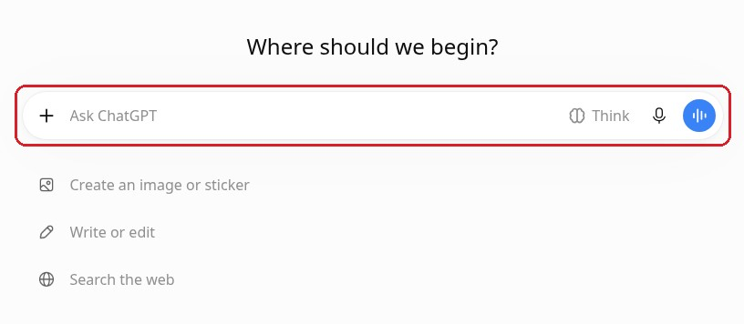
> 圖說：打開新對話後，畫面中間會看到一個長長的輸入框（紅框處），裡面寫著「Ask ChatGPT」。先點一下這裡，看到游標在閃動，就可以貼上提示詞。

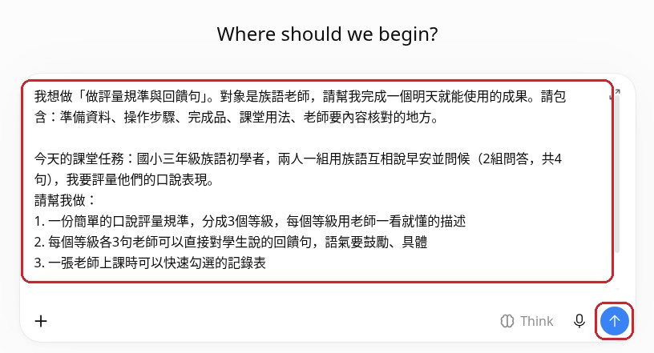
> 圖說：提示詞已經貼進輸入框（上面紅框），還沒送出。提示詞比較長，可以在框裡往下捲動，確認課堂任務、3 個等級、每級 3 句回饋句和記錄表都寫到了。確認後，點右下角圓形裡的向上箭頭（紅框處）。

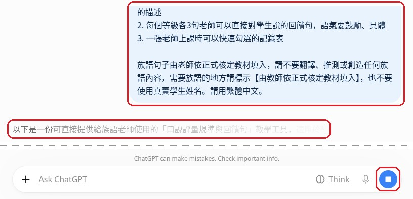
> 圖說：送出後，自己的提示詞會出現在右上方（上面紅框）。左邊開始出現回覆的第一句（中間紅框）。輸入框右側變成圓形裡有白色方塊（右下紅框），表示還在回答，等文字停止增加、白色方塊消失後再開始檢查。（這張圖把中間的空白處省略了。）

## 步驟 3：看 AI 給的第一版

你要先確認它是不是有產出這些東西：

- 有沒有清楚對應今天的課堂任務。
- 有沒有把作答方式、老師提醒或檢查重點寫出來。
- 有沒有標出哪些內容需要老師替換或修正。

這集期待的 AI 產出是：一份可檢查、可修改、可保存的第一版成果，包含清楚步驟、完成品草稿與內容核對點。

示範中，ChatGPT 直接用文字回覆，依序分成：一、成果一覽；二、成果一：三等級口說評量規準；三、成果二：每個等級各三句教師回饋語；四、成果三：教師快速勾選記錄表；五、課堂用法（第一步到第四步）；六、老師一定要核對的內容；七、正式使用前的最後檢查。

> 示範中的真實狀況：提示詞要求「準備資料、操作步驟」，但回覆裡沒有用這幾個字當標題。「一、成果一覽：明天上課要準備什麼？」其實就是準備資料，「五、課堂用法：明天上課的操作步驟」裡的第一步到第四步就是操作步驟。檢查時請看內容的意思，不要只找一模一樣的標題。

### 檢查一：有沒有對應今天的課堂任務

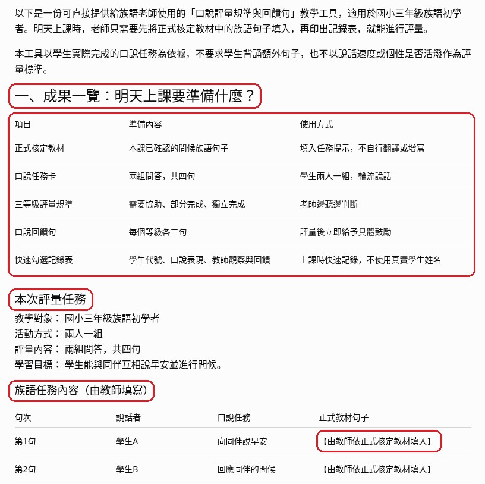
> 圖說：「一、成果一覽：明天上課要準備什麼？」（上面紅框）用一張表列出要準備的東西：正式核定教材、口說任務卡、三等級評量規準、口說回饋句、快速勾選記錄表。下面的「本次評量任務」寫明國小三年級族語初學者、兩人一組、兩組問答共四句，和今天的課堂任務一致。「族語任務內容（由教師填寫）」表格中，族語句子的位置都是【由教師依正式核定教材填入】（右下紅框）。

> 示範中的真實狀況：ChatGPT 沒有自己編出任何族語。每一個要放族語的地方，都保留【由教師依正式核定教材填入】。這正是我們要的結果。上課前，老師要把每個空格換成正式核定教材中的句子。

### 檢查二：有沒有寫出作答方式、老師提醒與檢查重點

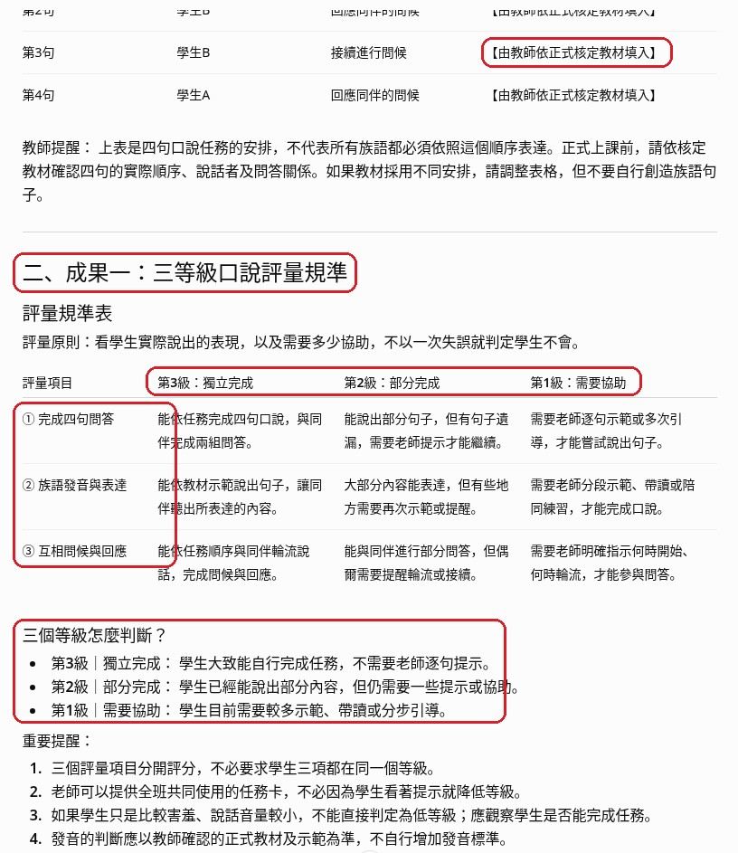
> 圖說：「二、成果一：三等級口說評量規準」（紅框處）。規準表的三個等級是「第3級：獨立完成」、「第2級：部分完成」、「第1級：需要協助」（橫向紅框）；左邊紅框是三個評量項目：①完成四句問答、②族語發音與表達、③互相問候與回應。下面紅框「三個等級怎麼判斷？」用一句話說明每一級。最上面的紅框是族語任務表裡的另一個族語空格，表格下方還有教師提醒：請依核定教材確認四句的實際順序。

> 小提醒：每一格的描述，老師要自己讀過，確認一看就懂、能在學生說話時馬上判斷。示範中的「重要提醒」也寫到：三個項目分開評分，學生害羞或音量小，不能直接判定為低等級。

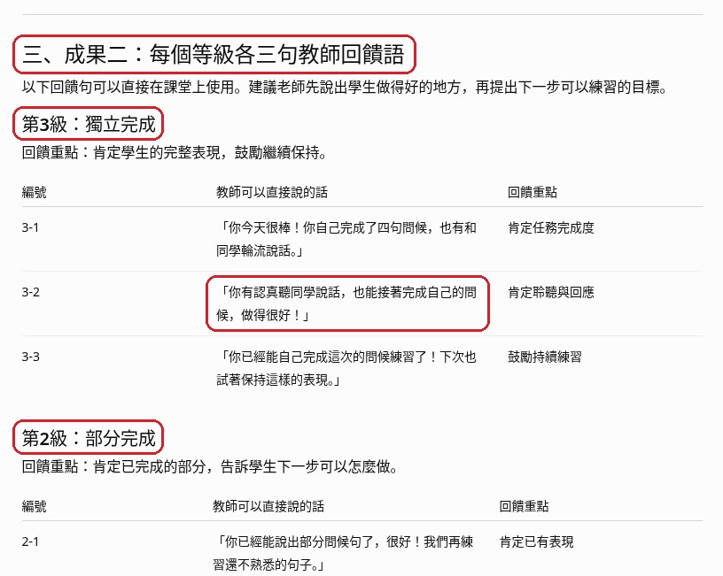
> 圖說：「三、成果二：每個等級各三句教師回饋語」（上面紅框）。每個等級一張表，有編號、老師可以直接說的話和回饋重點。第3級的 3-2 句（中間紅框）是：「你有認真聽同學說話，也能接著完成自己的問候，做得很好！」下面接著是第2級。

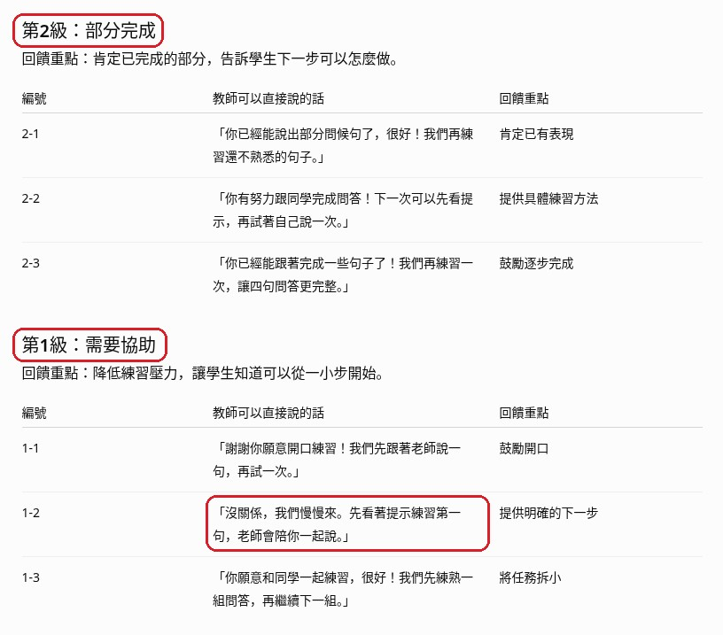
> 圖說：往下捲，是「第2級：部分完成」和「第1級：需要協助」的回饋語（紅框處）。第1級的 1-2 句（下面紅框）是：「沒關係，我們慢慢來。先看著提示練習第一句，老師會陪你一起說。」語氣鼓勵，也說出下一步可以怎麼做。

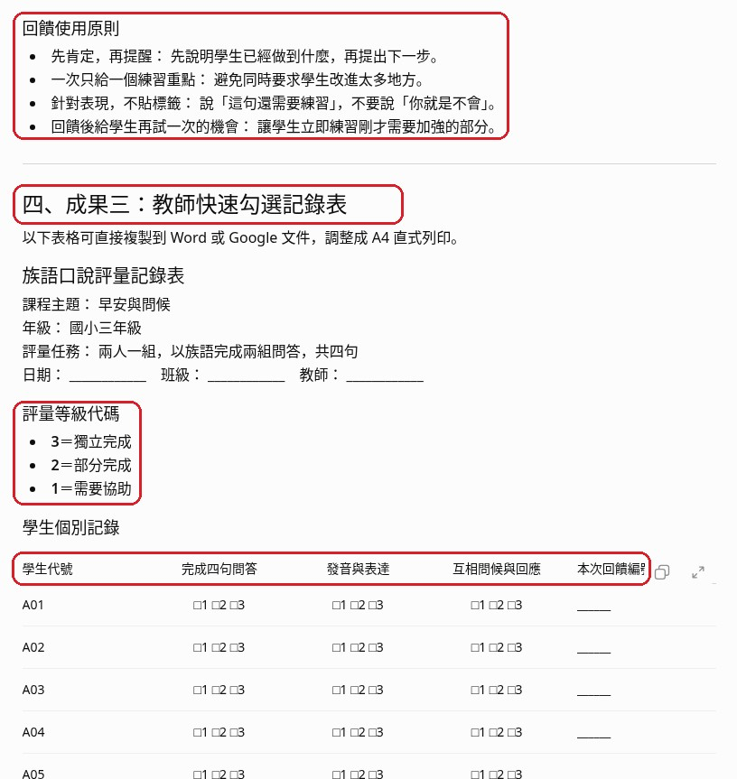
> 圖說：最上面紅框是「回饋使用原則」：先肯定再提醒、一次只給一個練習重點、針對表現不貼標籤、回饋後給學生再試一次的機會。下面是「四、成果三：教師快速勾選記錄表」（紅框處）：「評量等級代碼」3、2、1（紅框處），以及「學生個別記錄」表的欄位（最下面紅框），用 A01、A02 這類代號，三個評量項目各勾 1、2、3，不寫真實姓名。

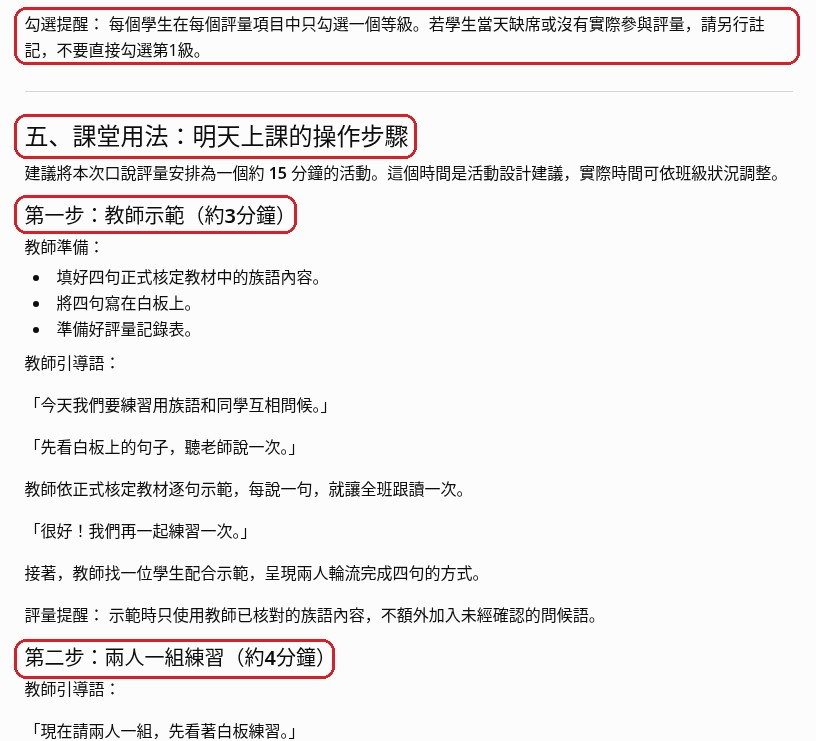
> 圖說：最上面紅框是記錄表的「勾選提醒」：每個項目只勾一個等級；學生缺席或沒有實際參與時要另外註記，不要直接勾第1級。下面是「五、課堂用法：明天上課的操作步驟」（紅框處），從「第一步：教師示範（約3分鐘）」開始，有教師準備和教師引導語，接著是「第二步：兩人一組練習（約4分鐘）」（紅框處）。

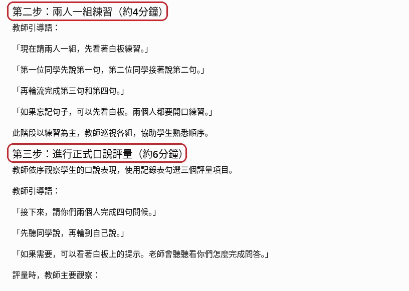
> 圖說：「第二步：兩人一組練習（約4分鐘）」和「第三步：進行正式口說評量（約6分鐘）」（紅框處）。每一步都寫了老師可以直接說的引導語。第三步說明老師依序觀察學生，用記錄表勾選三個評量項目。

### 檢查三：有沒有標出需要老師替換或修正的內容

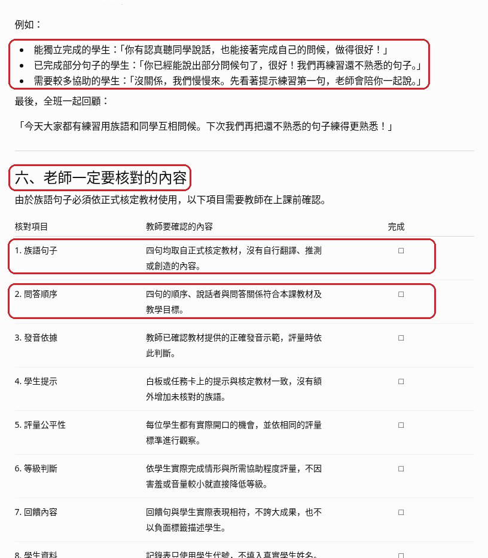
> 圖說：最上面紅框是課堂用法後段的回饋示範：依學生表現，從三個等級各挑一句回饋句來說。下面是「六、老師一定要核對的內容」（紅框處），表格列出 8 個核對項目和「完成」勾選欄。前兩項（紅框處）是「族語句子」：四句都取自正式核定教材，沒有自行翻譯、推測或創造；以及「問答順序」：四句的順序、說話者與問答關係符合本課教材。後面還有發音依據、學生提示、評量公平性、等級判斷、回饋內容與學生資料。

> 小提醒：示範中，回覆最後還有「七、正式使用前的最後檢查」，本講義沒有截圖。請記得捲到回覆最下面看完，再開始修改。

## 步驟 4：老師最後把關

- 成果是否真的能放進備課或課堂。
- 是否太多功能塞在同一集。
- 是否需要補真實截圖、來源或文化審查。
- 是否有任何 AI 杜撰、假畫面、錯誤族語或錯誤文化內容。

## 影片流程速記

- 1. EP022｜本集任務
- 2. 為什麼這集值得學
- 3. 老師先準備什麼
- 4. 打開工具
- 5. 輸入本集任務
- 6. 檢查第一版

## 今日金句

> 不要為了學功能而學功能。先問：這個成果明天能不能拿去備課或上課？能用，才值得教。

## 下一步

把這份草稿改成你自己班上能用的版本，再存成下次備課可以重複使用的模板。
